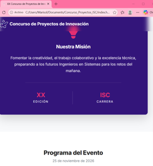
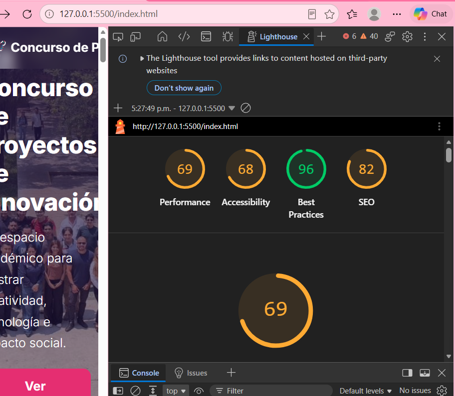
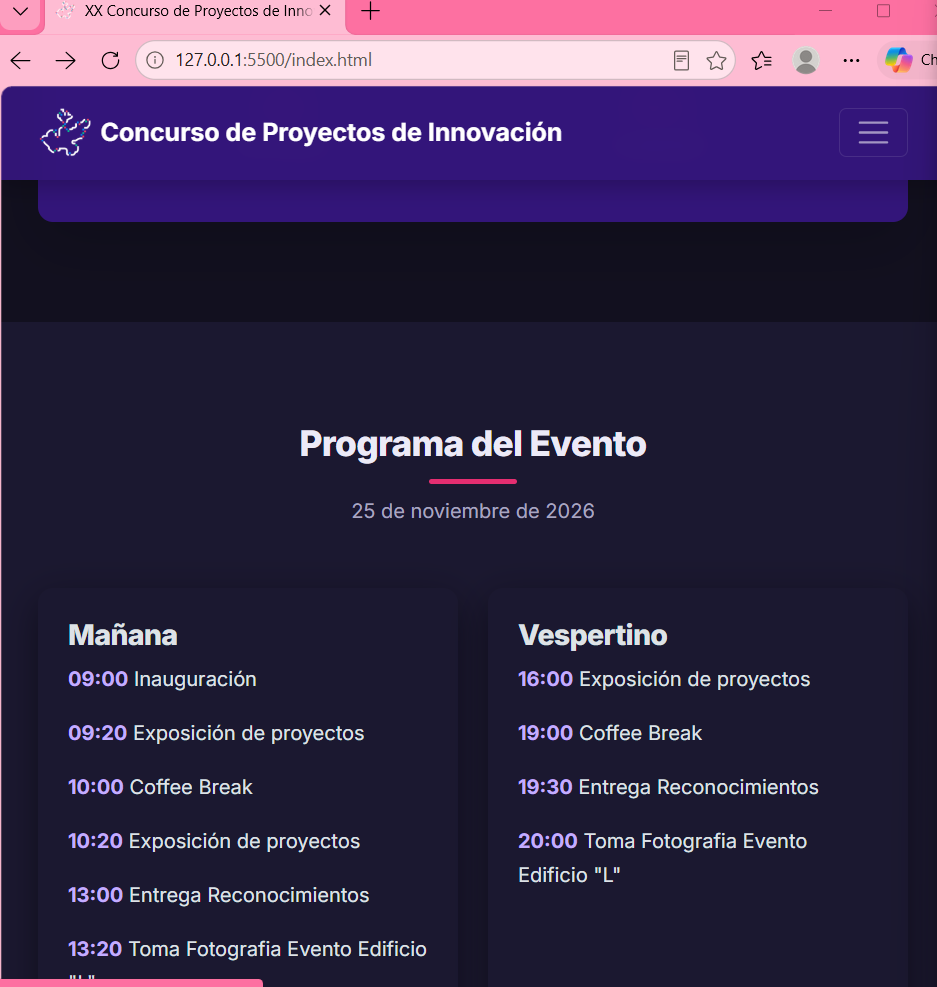
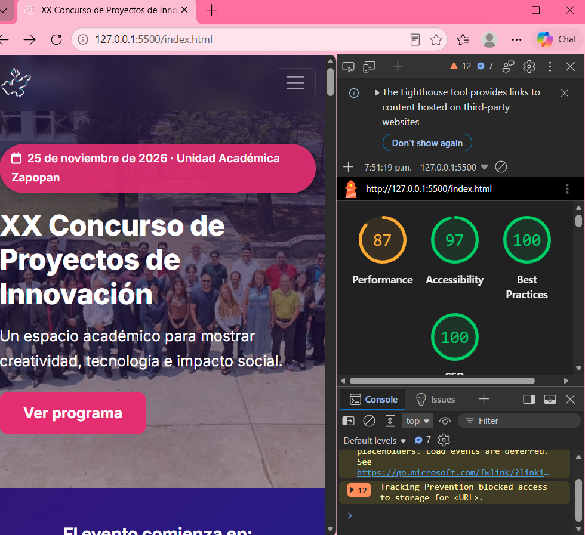

# XX Concurso de Proyectos de Innovación — ISC TSJ Zapopan

Sitio web oficial refactorizado, optimizado y con nuevas funcionalidades interactivas para la Academia de Ingeniería en Sistemas Computacionales del Tecnológico Superior de Jalisco (Unidad Académica Zapopan).

- **Sitio web en producción:** [https://natalaimarisolreyesv.github.io/Concurso_Proyectos_ISC/](https://natalaimarisolreyesv.github.io/Concurso_Proyectos_ISC/)
- **Repositorio oficial:** [https://github.com/NatalaiMarisolReyesV/Concurso_Proyectos_ISC](https://github.com/NatalaiMarisolReyesV/Concurso_Proyectos_ISC)
- **Rama principal de despliegue:** `main`

---

## 🛠️ Tecnologías y Librerías Utilizadas

- **HTML5 Semántico:** Maquetación estructurada (`<header>`, `<nav>`, `<main>`, `<section>`, `<article>`, `<aside>`, `<footer>`), metadatos SEO, Open Graph y Twitter Cards.
- **CSS3 Moderno:** Variables nativas CSS, diseño adaptativo Mobile-First mediante CSS Flexbox y CSS Grid, microinteracciones y modo oscuro.
- **JavaScript Moderno (ES6+):** Manipulación dinámica del DOM, temporizador asíncrono en tiempo real, validación de formularios y almacenamiento local con `localStorage`.
- **Bootstrap 5.3.2:** Sistema de rejilla y utilidades responsivas.
- **FontAwesome 6.5.0:** Iconografía vectorial interactiva y accesible.

---

## 🚀 Lista Detallada de Mejoras Implementadas

### 1. Estructura y Semántica Web (HTML5)
- Sustitución de contenedores genéricos `
` por etiquetas de bloque semánticas con roles estructurales claros.
- Integración de metadatos completos en el `<head>`: descripción SEO, palabras clave, etiquetas canónicas y Open Graph para previsualizaciones en redes sociales y mensajería.
- Cumplimiento de accesibilidad web (WCAG): enlace de salto directo al contenido (`skip-link`), atributos `aria-*` en navegación interactiva y textos alternativos (`alt`) descriptivos en imágenes.

### 2. Diseño, Maquetación y UX/UI (CSS3)
- Paleta cromática oficial del TecMM mediante variables CSS (`--primary: #33157A`, `--accent: #E52E71`, `--secondary: #1E208A`).
- Selector de tema **Modo Claro / Modo Oscuro** con persistencia en el navegador mediante `localStorage`.
- Microinteracciones suaves en enlaces de navegación, tarjetas interactivas y botones mediante transiciones y elevaciones con `transform`.

### 3. Dinamismo e Interactividad (JavaScript ES6+)
- **Contador regresivo dinámico:** Cálculo en tiempo real de días, horas, minutos y segundos restantes para el 25 de noviembre de 2026.
- **Validación interactiva de formulario:** Validación de campos en tiempo real (nombre, tipo de consulta, mensaje y verificación de correo institucional con dominio `@zapopan.tecmm.edu.mx`), incluyendo contador de caracteres y respuesta sin recargar la página.
- **Catálogo interactivo con filtrado DOM:** Sección de Proyectos Destacados con botones que filtran en tiempo real por áreas temáticas (Inteligencia Artificial, Web y Móvil, IoT).

### 4. Rendimiento y Buenas Prácticas
- Optimización en la carga de recursos mediante preconexión de fuentes y carga perezosa (`loading="lazy"`).
- Precarga de imagen principal del banner (`rel="preload"`) para optimizar el LCP (Largest Contentful Paint).
- Auditoría en Google Lighthouse con puntuaciones superiores a 85 en todas las categorías clave (Performance: 87, Accessibility: 97, Best Practices: 100, SEO: 100).

---

## 📸 Comparativa Visual: Antes y Después

### Estado Inicial (Antes)

### Auditoría Inicial en Lighthouse

### Avance del Sitio con Modo Oscuro (Después)

### Auditoría Final en Google Lighthouse (Superando 85 puntos)
